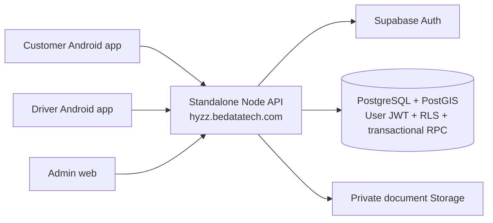

> **1.2.0 update:** read [VERCEL-TESTING.md](VERCEL-TESTING.md) first. Apply new migrations 004 and 005 after existing 001–003. Node/IONOS SMTP delivery and database-backed rate limits are now the defaults and require the server-only service key. Supabase-dashboard SMTP applies only to the optional supabase delivery mode. API: https://api.srtechcreators.in; admin: https://hyzz.srtechcreators.in.

# Separated Hyzz architecture

`backend/` deploys independently with its own npm package/lockfile, environment and route modules. It does not serve or require mobile/frontend source. Supabase remains the configured Auth/database/Storage provider. Node uses verified user JWTs for ordinary operations; the service role is restricted to permission-checked Auth-account provisioning.

`frontend/customer` and `frontend/driver` own their entry points, app settings, API override, role-specific screens, screenshots and APK outputs. `frontend/admin` owns its web package and deployment bundle. `frontend/shared` holds reusable React Native UI, secure session storage, trip/account screens and a single API transport. Development uses the complete monorepo; backend and compiled frontend artifacts deploy separately.

PostgreSQL retains the previously tested transactional state machine, row locking, hashed trip OTPs, price snapshots, immutable fare/ledger records and role enforcement. The new Node boundary adds JWT validation, active-account checks, strict contracts, bounded reads, upload signature/size checks, rate limits, explicit CORS and safe errors. Neither a frontend role nor a fare/payment flag grants authority.

Mobile tokens use SecureStore; admin and browser-preview sessions use memory. Browser preview storage is deliberately not treated as native secure storage. All business/Auth calls go through Node. Expiring authorized document downloads may use a provider-signed URL. Foreground polling reconciles state; no background push or direct provider WebSocket connection is assumed.

See EDIT-AND-BUILD.md for feature locations, DEPLOY-NODE.md for deployment and api.md for endpoint contracts. Legacy direct-provider docs under `docs/legacy` are retained only as historical notes and are superseded by these guides.
