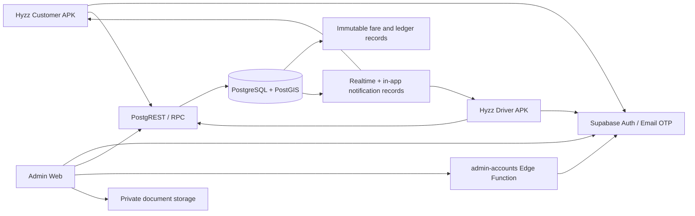
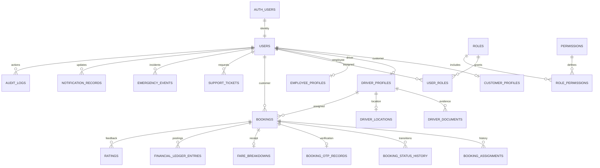

# Architecture and boundaries

Hyzz supplies a shared JavaScript Expo application compiled for **two audiences**, separate Android application IDs and isolated app storage. Customer and driver apps cannot change account permissions by switching audience. A web-only React/Vite admin uses the same Supabase project. JavaScript is used throughout; no TypeScript conversion was introduced.

`App.js` loads `apps/mobile/HyzzApp.js`; `app.config.js` selects customer or driver based on `HYZZ_APP_VARIANT`. Mobile styling uses only React Native StyleSheet. `src/lib/supabase.js` chunks session data into Android Keystore-backed Expo SecureStore. AppState starts/stops token refresh. Admin sessions are held in memory, so refresh requires login again. Neither app stores user passwords.

The backend is Supabase's authenticated PostgREST API plus transactional SQL RPCs, not a separately hosted pretend API. Clients cannot write to application tables directly. Security-definer functions use a fixed empty search path, explicit `auth.uid()` checks and server-side role enforcement. RLS restricts reads. PostgreSQL triggers maintain event history and reject edits/deletes on pricing versions, fares, ledger entries and audit records.

Booking acceptance locks the booking row and serializes competing actions for the same driver using a transaction advisory lock. A partial unique index adds one-current-trip-per-driver protection. Booked duration prevents more than one assignment; the pilot deliberately allows only one current assignment, including upcoming pickups. Customer booking retries are deduplicated by customer/request UUID, under a customer advisory lock. A different key cannot create another active booking for the same customer.

Matching uses PostGIS geography in metres, current location (<5 minutes old), current documents, account status, availability and a configured radius. Driver-side requests are a bounded nearest-first list. This pilot does not persist push offers or claim background delivery. Location is uploaded for availability while Requests is foregrounded and during the pre-trip pickup screens. Customer access is allowed only for their assigned driver's pre-trip location (<2 minutes old). Starting the trip sets driver offline and deletes the location. No active-trip distance is measured; distance billing is unavailable.

Trip OTPs are crypto-random, BCrypt-hashed, booking-scoped, expire in 10 minutes, permit five attempts, and have a 60-second regeneration cooldown plus issuance limits. Failed guesses return a result rather than rolling back the attempt increment. Verification records OTP_VERIFIED in history and starts the trip in the same transaction, using server timestamps. OTP hashes have no client read policy; plaintext is returned only to the booking's customer when issuing it. Do not enable request-body logging of OTP verification requests.

Money is integer paise (BIGINT) with NUMERIC percentage/rounding calculations. This is decimal-safe fixed-point storage. Fare snapshots freeze price and commission rules. A booked duration is the minimum billable time; extra duration rounds up in 15-minute increments. Full-day means 8 included hours, no distance allowance. No hidden taxes, customer commission or expenses are added. New prices only affect new bookings. Initial settings need business approval.

Completion posts earnings and commission-due entries, independent of payment confirmation. Cash requires both customer and driver confirmations, posts one idempotent cash-collected entry and remains money held by the driver. No bank transfer or platform collection is implied. Disputes retain the original fare and ledger. Online settlement, refund/payout initiation and financial correction posting are disabled until a verified provider and approval workflow are implemented. The absence of an edit endpoint is deliberate; operators cannot rewrite money to resolve a dispute.

## Entity relationships

Tables for unused gateways/promotions are not added to imply features that do not exist. See `docs/feature-status.md` for remaining work and `docs/verification.md` for test evidence.
